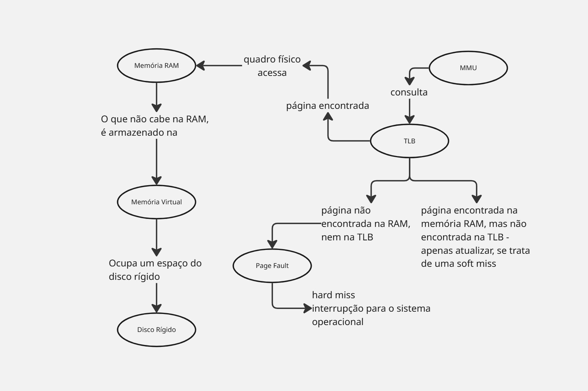

## Diário de Bordo: Encontro 8

**Disciplina:** Sistemas Operacionais 
**Tema:** Diagnóstico de Arquitetura - O Gargalo da Memória Virtual 
**Alunos:** Nivea Sofia da Cas || Roberto Müller

## Parte A: O Fenômeno da Paginação e o Gargalo do Disco

### 1. O que é um "Page Fault" (Falta de Página)?
Um page fault (falha de página) é o evento que ocorre quando um processo faz referência a uma página virtual que não se encontra carregada na memória principal (RAM) naquele momento. Em sistemas que utilizam a estratégia de "Paginação por demanda", os processos iniciam sem nenhuma página na memória.

 Assim que a CPU tenta executar uma instrução ou aceder a um endereço cuja página não está presente na RAM, é gerado um page fault. O S.O. então utiliza uma interrupção (trap) para interromper temporariamente a execução, buscar a página necessária na memória secundária (disco) e trazê-la para a memória principal.  

 ### 2. Por que o excesso de Page Faults deixa a CPU ociosa e o disco rígido sobrecarregado?

O excesso de page faults (fenómeno conhecido como thrashing) provoca essa situação devido a fatores técnicos ligados ao tempo de resposta do hardware e ao gerenciamento de estados dos processos. 

Quando ocorre um page fault, o processo em execução não pode prosseguir porque os dados ou instruções exigidos não estão na RAM. O sistema operativo é obrigado a colocar o processo num estado de espera (blocked). Para resolver a falha, o S.O. precisa aceder ao disco rígido para ler a página ausente. 

Os discos mecânicos e operações de E/S possuem uma velocidade de acesso infinitamente mais lenta do que a da memória RAM e da CPU. Com uma taxa excessiva de falhas de página, o disco rígido fica sobrecarregado com um fluxo contínuo e intenso de pedidos de leitura e escrita para carregar e descarregar páginas de forma constante. Enquanto o disco processa lentamente essas operações de E/S, os processos ficam bloqueados à espera dos dados.

 Como a CPU é extremamente rápida, ela esgota rapidamente quaisquer micro-tarefas pendentes e fica ociosa — ou a desperdiçar ciclos de processamento à espera que as operações de disco fiquem prontas —, pois não há dados úteis na RAM para continuar a processar.

## Parte B: O Papel e a Eficiência da TLB

### 1. O que é a TLB (Translation Lookaside Buffer) e por que ela é implementada em hardware (na MMU) em vez de ser uma tabela comum na memória RAM?

É um pequeno dispositivo de hardware que mapeia os endereços virtuais para endereços físicos sem precisar passar pela tabela de páginas.

Porque, se ela estivesse na memória RAM, seriam necessários dois pontos de referência, ou seja, dois acessos à memória: um para acessar a tabela de páginas e outro para acessar o dado propriamente.

Assim, na MMU, ela confere se o número da página virtual está na TLB, comparando todas as entradas simultaneamente. A tabela de páginas só vai ser acessada se o número da página não estiver na TLB.

### 2. Explique como uma alta taxa de "TLB miss" (erros na TLB) afeta o tempo de resposta do servidor. O que acontece com o conteúdo da TLB a cada vez que o Sistema Operacional realiza uma troca de contexto entre os processos do banco de dados?

Depende se é **soft miss** ou **hard miss**.

- **Soft miss:** ocorre quando a página referenciada não se encontra na TLB, mas está na memória. Só é necessário atualizar a TLB, em torno de 10 a 20 instruções, que levam nanossegundos. Embora mais leve, ainda exige acessos extras à memória.
- **Hard miss:** ocorre quando a página não está na memória e nem na TLB. É necessário acessar o disco, o que pode demorar vários milissegundos, dependendo do disco usado. Uma hard miss é bem mais demorada do que uma soft miss.

Em caso de uma alta taxa de misses, o tempo médio de acesso à memória aumenta e as respostas ficam mais lentas.

**Troca de contexto:** a cada troca de contexto, a TLB precisa ser descarregada para se livrar de traços do processo que estava sendo executado, pois as entradas guardam mapeamentos do processo anterior, e uma mesma página virtual aponta para quadros diferentes em cada processo. Então a tabela de páginas do novo processo, se torna a atual.

O novo processo gera uma sequência de misses até reconstruir o conjunto de páginas ativas. Em um banco de dados, com muitos processos se alternando, isso custa desempenho.

## Parte C: Síntese e Solução

### 1 Se a empresa decidir dobrar a quantidade de memória RAM física do servidor, como isso impactaria a taxa de Page Faults e o uso do disco? Justifique utilizando o conceito de Memória Virtual.

Com o dobro de memória RAM física, o servidor expande a capacidade de frames (molduras) reais, trazendo um impacto direto e positivo através do conceito de Memória Virtual:  

 #### Queda drástica de Page Faults:
  
 Com mais espaço na RAM, o sistema operativo consegue manter um conjunto muito maior de páginas ativas residentes em simultâneo, reduzindo a necessidade de recorrer à memória secundária. 

 #### Alívio no disco e na CPU: 
 Menos falhas de página significam uma redução drástica nas operações de leitura e escrita (E/S) no disco. Isto elimina a sobrecarga da memória secundária e evita que a CPU fique ociosa à espera de dados.

## Mapa Mental

    
     Fonte: elaborado pelos autores (2026).

## Referências

### Texto

TANENBAUM, Andrew S.; BOS, Herbert. **Sistemas operacionais modernos**. Tradução: Jorge Ritter. Revisão técnica: Raphael Y. de Camargo. 4. ed. São Paulo: Pearson Education do Brasil, 2016.

### Vídeo

DICIONÁRIO DE INFORMÁTICA. Memória VIRTUAL. [S. l.]: YouTube, 11 set. 2020. 1 vídeo (9 min 34 s). Disponível em: https://www.youtube.com/watch?v=z11N1DhgYO0.